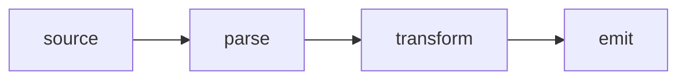

# Vocabulary, add-ons, themes and behaviour

Read this when a note uses names such as `:::theorem`, `:::note` or `::toc`; when you add a numbered kind of element, labels in another language, a theme, code colours or diagrams; or when you write CSS or a script for a note. The syntax is in [syntax.md](syntax.md), every code in [diagnostics.md](diagnostics.md), the commands in [tools.md](tools.md).

## What a vocabulary is

Luccet's core knows how a name is *written* (`:::name`, `::name`, `:name[…]`), not what it *means*. A **vocabulary**, or schema, gives a name its element, label, counter, reference text, title slot, end mark, table of contents, stylesheet and behaviour. The core declares no names at all, so without a vocabulary `:::theorem` is a plain `div.t-block.theorem`: no label, no number, and `@id` reads its title (or, untitled, its id).

```luccet
:::theorem[Rank–nullity]{#rn}
$\dim V = \dim \ker T + \dim \operatorname{im} T$.
:::

See @rn.
```

That renders as a `div` with the title "Rank–nullity", and `@rn` reads "Rank–nullity". With a vocabulary that declares `theorem` (here the demo schema, below), the same source is a `<section>` labelled "Theorem 1", and `@rn` reads "Theorem 1":

```luccet schema=demo
:::theorem[Rank–nullity]{#rn}
$\dim V = \dim \ker T + \dim \operatorname{im} T$.
:::

See @rn.
```

The difference is one entry: `theorem: {tag: 'section', counter: 'theorem', label: 'Theorem', ref: '{label} {n}'}`.

A name with no entry still renders, and nothing warns unless the schema is [strict](#strict-names):
- an HTML name allowed at that level becomes that element: `:::aside`, `:::details`, `::video`, `:kbd[…]`;
- a lower-case name with a hyphen becomes a custom element: `:::tide-panel`;
- any other name becomes a `div` (block, leaf) or `span` (inline) with the name as its class.

Every named element keeps its name as a class and as `data-t="name"`, so CSS and behaviours can find it. Names are case-sensitive: `:::Theorem` does not find `theorem`.

## Before you edit: read the note's vocabulary

1. **The head**, before the luccet.js line: a `<script>` that sets `window.LUCCET = {schema: {…}}`, inline or as `<script src="vocab.js">`.
2. **`data-use`** on the luccet.js line and a **`:::use`** block at the top of the note: each script entry (not ending in `.css`) may declare names with `luccet.block`, `luccet.leaf` and `luccet.inline`. Open the local ones and search for those calls. `.css` entries are styles only.
3. **The body**: the names already in use.

Then:
- **Use the names the vocabulary declares.** If it has `:::note`, write `:::note`, not `:::callout` or a GitHub `> [!NOTE]`.
- **Never type a number.** No "Theorem 3", "Figure 2", "Table 1" or "(4)" in the text: give the element an `{#id}` and write `@id`. To number a new kind of element, add an entry with a `counter` to the schema, then use it.
- **A name the vocabulary lacks** is either an HTML name (`:::aside`, `:::details[Summary]`, `:::figure`), or something to declare. Do not leave a meaningful-looking `:::lemma` undeclared in a note whose vocabulary has `theorem`: declare it on the same counter.
- **Change the vocabulary where it lives.** A note's own entries are in its head. An add-on shared by other notes is not yours to edit for one note: override in the head (see precedence) or ask.

**Precedence.** Add-ons run in the order listed (the tag's `data-use`, then the `:::use` block), and a later one that declares a name replaces the earlier entry. Then `window.LUCCET.schema` is applied on top: the note's entry replaces an add-on's entry for the same name **whole**. Fields are not merged, and the add-on's `dom` for that name is gone unless the note's entry has one.

## Declaring vocabulary in the head

A note that stands alone declares its names in a classic `<script>` before the luccet.js line. The value has the registry's shape: `block` for `:::` names, `leaf` for `::` names, `inline` for `:` names, each optional.

````html
<!doctype html><html lang="en"><meta charset="utf-8"><title>Rank–nullity</title>
<script>
window.LUCCET = {schema: {
  block: {
    theorem: {tag: 'section', counter: 'theorem', label: 'Theorem', ref: '{label} {n}'},
    lemma: {tag: 'section', counter: 'theorem', label: 'Lemma', ref: '{label} {n}'},
    proof: {tag: 'section', label: 'Proof', end: '∎'},
    figure: {tag: 'figure', counter: 'figure', label: 'Figure'},
  },
  leaf: {toc: {tag: 'nav', transform: 'toc', attrs: {'aria-label': 'Contents'}}},
  inline: {key: {tag: 'kbd'}},
}};
</script>
<script src="luccet.js"></script>

::toc

## The theorem

:::theorem[Rank–nullity]{#rn}
$\dim V = \dim \ker T + \dim \operatorname{im} T$.
:::

:::proof
Extend a basis of $\ker T$ to a basis of $V$.
:::

## Using it

By @rn, … Press :key[Ctrl].
````

The toc is a `nav` listing both headings, the theorem a `section` labelled "Theorem 1", the proof ends with ∎, `@rn` reads "Theorem 1", and `:key[Ctrl]` is a `<kbd>`.

- **Where.** A classic script in the head, before the luccet.js line. A `<script>` inside the note runs after the note is rendered: too late to declare names for it.
- **Function fields** (`label`, `dom`) and `css` work here as in an add-on.
- **A bad entry** (a reserved name, a value that is not an object) is skipped with a console warning; the others apply.
- **`window.LUCCET`** carries other settings too: `lang` (label language) and `use` (per-add-on options, keyed by the add-on's file name — the KaTeX add-on reads `use: {katex: {macros: {…}, …}}`).
- **Under the command line.** `luccet check`, `luccet build` and the language server run the head's classic scripts too, so they see the same vocabulary (in a separate context, which is not a security boundary: [Trust](tools.md#trust)). A remote `src` is not run (`head.script`, info); a missing file or a script that throws is `head.script` (warning). Scripts with `async`, `defer` or `type="module"` are not run.

## Add-ons: `data-use` and `:::use`

An add-on is a script or a stylesheet listed, space-separated, in `data-use` on the luccet.js tag:

```html
<!doctype html><meta charset="utf-8"><script src="luccet.js" data-use="themes/gruvbox.css addons/code.js"></script>
```

or, one or more per line, in a `:::use` block, the readable form for several. It must lead the note: top level, before any content, with only `:::meta` and blank lines before it; one anywhere else is `use.late` (error) and ignored. Both forms merge, the tag's entries first. The block emits nothing.

```html
<!doctype html><meta charset="utf-8"><script src="luccet.js"></script>

:::use
themes/gruvbox.css
addons/code.js
:::
```

| Entry | Is | Under `luccet check` |
|---|---|---|
| ends in `.css` (before any `?query`) | a stylesheet, linked in its place in the cascade | not run; a missing local file is `link.missing` |
| anything else (`.js`, `.mjs`, no extension) | a classic script, run before the note is rendered | run: its vocabulary and transforms count |
| a local script that is missing, a directory, does not parse, or throws | | `addon.failed` (error, at the luccet.js line, or at the entry's line in `:::use`) |
| a remote script (`https://…`) | loaded by the browser | not loaded: `addon.remote` (info); the names it declares are unknown to the check |
| a remote stylesheet | loaded by the browser | nothing reported |

- **Paths** are URLs relative to the note, like any `src`: from `notes/a.html` write `data-use="../themes/nord.css"`, as its luccet.js line has `src="../luccet.js"`. Under the command line a root-relative path (`/lib/x.js`) resolves from the note's folder or the nearest ancestor that has it.
- **Order.** Scripts download in parallel and run in the order listed; a later add-on sees and can change an earlier one's entries. Stylesheets cascade in the order listed: a theme listed after another CSS add-on wins at equal specificity.
- **Options** go in the query string and arrive in `luccet.config.use.NAME`, where NAME is the file name without its folder, `.min` and extension: `data-use="lib/callout.min.js?collapse=all"` gives `luccet.config.use.callout.collapse === 'all'`. Write `&` as `&amp;` in strict HTML; both work. In a `:::use` entry, write `&` as it is. Defaults can sit in `window.LUCCET = {use: {callout: {…}}}`; the query wins key by key.
- **Failure never blanks the note.** A script that fails to load renders the note without it; one that throws renders it with what it registered before the error. Both are `addon.failed`.
- **A remote add-on that declares names** makes `luccet check` blind to them: under strict names those names show as `name.unknown`, and `luccet build` warns that the page uses them without their entries. Prefer a local copy when the vocabulary matters to the check. `addon.remote` alone does not fail the check.
- **`luccet new FILE --use="../themes/nord.css ../addons/code.js"`** writes the list as a `:::use` block, one entry per line as given, relative to the new note, and warns about a local entry that does not exist.

```html expect="addon.remote"
<!doctype html><meta charset="utf-8"><script src="luccet.js" data-use="https://cdn.jsdelivr.net/gh/Luccet/luccet@TAG/addons/code.js https://cdn.jsdelivr.net/gh/Luccet/luccet@TAG/themes/nord.css"></script>

# Remote add-ons
```

From jsDelivr, give each add-on and theme the same TAG as the note's `luccet.js`.

## The schema fields

Every field is optional. A field that does not apply at the entry's level is ignored.

| Field | Value | Levels | What it does |
|---|---|---|---|
| `tag` | an element name | all | the element, from the level's allowlist |
| `class` | classes, space-separated | all | classes before the author's |
| `attrs` | `{key: value}` | all | default attributes; the author's win |
| `counter` | a counter name | all | numbers the elements; entries with the same counter share it |
| `within` | `'h1'` … `'h6'` | all, with `counter` | restarts the counter per section: "Problem 2.1" |
| `label` | string, `{lang: string}` map, or `(n, node) => text` | all | "Theorem 2", "Proof", "Note" |
| `ref` | template over `{label}` `{n}` `{title}` `{id}` | all | what `@id` reads |
| `title` | `block`, `inline`, `summary`, `figcaption`, `caption`, `legend` | block | the title element |
| `titleDefault` | text | block | the title when none is written |
| `body` | `'blocks'` (default) or `'raw'` | block | `'raw'` keeps the body verbatim, as `{raw}` does |
| `end` | text | block | a mark at the end: ∎ |
| `transform` | `'toc'` | leaf | fills the leaf with a table of contents |
| `depth` | `'N'` or `'A-B'` | leaf with `transform` | heading levels listed; default `'2-3'` |
| `css` | CSS text | all | a stylesheet, added in the browser when the entry is registered |
| `dom` | `(el) => void` | all | a behaviour, run on each element like `luccet.define` |

```js
luccet.block('theorem', {tag: 'section', counter: 'theorem', label: 'Theorem', ref: '{label} {n}'});
luccet.block('note', {tag: 'aside', class: 'callout', attrs: {role: 'note'}, label: {en: 'Note', de: 'Hinweis'}});
luccet.block('more', {tag: 'details', titleDefault: 'Show more'});
luccet.block('chart', {body: 'raw'});
luccet.leaf('player', {tag: 'video', attrs: {controls: true, preload: 'metadata'}});
luccet.leaf('bib', {counter: 'bib', ref: '[{n}]'});        // @knuth reads [1]
luccet.inline('key', {tag: 'kbd'});
```

The same entries go into `window.LUCCET.schema` as `block: {theorem: {…}, note: {…}}`, `leaf: {…}`, `inline: {…}`.

**`tag`.** It must be on the level's allowlist: flow containers for blocks (`section`, `aside`, `details`, `figure`, `nav`, `table`, `fieldset` …), those plus media and `figcaption legend p summary` for leaves (`video`, `img`, `iframe` …), phrasing elements for inline names (`kbd`, `abbr`, `dfn`, `button`, `q` …). A tag outside it is ignored with `tag.not-allowed`; a reserved one (`main`) with `name.reserved`. Custom elements are on no allowlist: to get `<chart-box>`, write `:::chart-box`, not `tag: 'chart-box'`. An author's `{tag=…}` on the element beats the schema's. A void leaf (`img`, `hr`) has no content: bracket text follows it in a paragraph (`leaf.void-content`).

**`class` and `attrs`.** Class order: `t-block` (containers), the name, the entry's `class`, the author's classes. In `attrs`, `true` gives a boolean attribute, `false`/`null`/`undefined` omit it, anything else becomes a string; `attrs.id` is ignored (every element would share it), and so are the keys `tag`, `raw`, `cols`, `ref` and `data-t`. The author's attribute replaces a default key by key.

**`counter`.** A counter is a name. Entries giving the same counter share one sequence, at any level: Theorem 1, Lemma 2, Corollary 3. Numbering is document-wide and in document order; an outer block is numbered before the blocks inside it. Counted with no `label`, the label is the bare number.

**`within`.** `within: 'h2'` restarts the counter at each `##` and prefixes the section number: "Problem 2.1". `h1` stands outside the section numbers (a title or a part); `within: 'h3'` gives "Claim 2.1.3", with 0 for a missing level. Entries sharing a counter share its `within`. On the counter `equation` (`{counter: 'equation', within: 'h2'}` on any entry) equations read "(2.1)".

**`label`.**
- A string is the label word; with a counter Luccet appends the number: "Theorem 2".
- A map `{en: 'Lemma', de: 'Hilfssatz'}` picks the word by the note's language (below).
- A function `(n, node) => text` returns the **whole** label; Luccet adds no number. `n` is the number (a string such as `"2.1"` under `within`, `undefined` without a counter). It gets no language. With a function, write `ref: '{label}'` or no `ref`: `'{label} {n}'` would repeat the number.
- An empty string, or a function returning `''`, `null` or `undefined`, gives no label.
- On a container the label is `span.t-label`, first in the title element, which exists even when no title is written (`:::theorem[]` shows the label alone). A leaf or inline element has no title: its label is its own first child.
- Labels are real text, not CSS `content`: they copy, print, search and reach screen readers.

**`ref`.** A template: `{label}` is the label word (or a label function's whole result), `{n}` the number as shown, `{title}` the title as written, `{id}` the id; everything else is literal. When the target lacks a part the template names (an untitled exercise under `'{label} {n} ({title})'`), the default text is used instead.

**`title`.** Without it, the slot follows the tag: `details` → `summary`, `figure` → `figcaption` (last child), `table` → `caption`, `fieldset` → `legend`, anything else → `div.t-title`. `block` and `inline` work in any element and override the tag's slot; the other four only in their own element.

**`titleDefault`.** Plain text used when no title, or `[]`, is written; references read it as the title.

**`body: 'raw'`.** The body is one text node: nothing in it is Luccet, and it ends only at a bare `:::` or `:::/name`. For data a behaviour reads (`el.textContent`). `'inline'` is accepted but read as `'blocks'`.

**`end`.** `span.t-end` with `aria-hidden`, the container's last child (just before a `figcaption`; dropped in a merged table).

**`transform` and `depth`.** See the table of contents below.

**`css`.** Added through `luccet.style` in the browser: at the add-on's place in the cascade, or after all add-ons when it comes from `window.LUCCET.schema`. Ignored under node: `luccet build` writes no stylesheet for it; the browser adds it when the built page starts. Replacing an entry does not remove CSS an earlier entry added.

**`dom`.** Called once per element in the browser, before any `luccet.define` function for the name; never under node. `luccet.undefine` does not remove it.

## Numbering and references

| Numbered | How | `@id` reads |
|---|---|---|
| A schema name with `counter` | in document order, per counter | "Theorem 1", or the `ref` template |
| A display equation with an id | counter `equation`, with or without a schema | "(1)" |
| A titled fence (listing) | the `code` entry's counter, when declared | "Listing 1" |
| An image alone in its paragraph with an id | the `figure` entry's counter, when declared | "Figure 1" |
| `:::table[Caption]` around one pipe table | the `table` entry's counter, when declared | "Table 1" |
| Footnotes | by first reference, on their own sequence, always | (referenced with `[^label]`) |

```luccet schema=demo
:::theorem
First.
:::

:::definition
Its own counter: Definition 1.
:::

:::lemma
Shares the theorem counter: Lemma 2.
:::

:::corollary
Corollary 3.
:::
```

```luccet schema=demo
# Problem sets

## Vectors

:::problem{#p-sum}
:::

:::problem
:::

## Matrices

:::problem
:::

See @p-sum.
```

In the demo schema `problem` is `within: 'h2'`: the problems read 1.1, 1.2 and 2.1, and `@p-sum` reads "Problem 1.1". The `#` heading does not count.

**What `@id` reads by default:**

| Target | Text |
|---|---|
| a counted element | its label and number, "Theorem 1", or its `ref` template |
| an equation | "(1)" |
| a heading | its content |
| a titled element that is not counted | its title |
| a labelled element, neither counted nor titled | its label, "Proof" |
| anything else | the id |

`@id{ref=label}` gives the whole label ("Theorem 1"), `ref=number` the number, `ref=title` the title, `ref=full` "Theorem 1 (Rank–nullity)". A part the target lacks falls back to the default text; any other value is `attr.malformed`. For your own words, link to the fragment: `[the main result](#rn)`.

```luccet schema=demo
:::theorem[Rank–nullity]{#thm-rn}
:::

:::note[Units]{#units}
:::

:::proof{#pf}
:::

$$ x $$ {#eq-x}

- @thm-rn, @thm-rn{ref=title}, @thm-rn{ref=full}, @thm-rn{ref=number}
- @units, @pf, @eq-x
```

## Names the core consults: listings, figures, tables

Three entries apply to constructs not written as `:::name`. Declare them to number those constructs.

- **`code`**: a fence with a title (```` ```js [Title]{#id} ````) is a listing, `figure.t-block.code`, counted and labelled by the `code` entry ("Listing 1" in the demo). An untitled fence is never counted. The entry's `tag`, `class` and `attrs` do not apply to fences.
- **`figure`**: a paragraph holding only an image with an id becomes a figure container, the same as `:::figure[alt text]{#id}`, counted by the `figure` entry. Without an id it stays an image. Without a schema it is still a `<figure>` with a caption, unnumbered.
- **Any entry whose `tag` is `table`**: the container merges with the one pipe table it holds, and its title becomes the `<caption>`. Without a schema `:::table[…]` merges the same way, with no number. A body that is not exactly one pipe table makes it a `div` (`table.body`).

````luccet schema=demo
```js [Naive Fibonacci]{#lst-fib}
const fib = (n) => (n < 2 ? n : fib(n - 1) + fib(n - 2));
```

{#fig-tides}

:::table[Phases]{#tbl-phases}
| Phase | Exit |
|---|---|
| P0 | every rule has a case |
:::

See @lst-fib, @fig-tides and @tbl-phases.
````

## The table of contents leaf

`::toc` lists the headings only when the vocabulary declares a leaf with `transform: 'toc'`. Without one, `::toc` is an empty `div.toc` and nothing warns: check the vocabulary before you add it.

```js
toc: {tag: 'nav', transform: 'toc', depth: '2-3', label: 'Contents'}   // in leaf: {…}
```

- **Any leaf name** works (`contents: {transform: 'toc'}`); on a container `transform` does nothing.
- **`depth`**: `'A-B'` or `'N'` (from the lower bound to N); default `'2-3'`. `::toc{depth=2-4}` on the leaf overrides it; with the default range, `{depth=2}` is level 2 only.
- **Output**: `ol > li > a`, nested per level, linking each heading's id (written or generated). A `label` shows before the list. With no heading in range nothing is written, label included.

```luccet schema=demo
::toc{depth=2-4}

## Kernel

### Definition

#### A detail

## Image
```

## Labels in other languages

Give `label` a map, and the note's language picks the word; references follow it.

```js
lemma: {tag: 'section', counter: 'theorem', label: {en: 'Lemma', de: 'Hilfssatz', fr: 'Lemme', 'pt-BR': 'Lema'}}
```

**The language** is the first of: `data-lang` on the luccet.js tag; `window.LUCCET.lang`; `lang` in a top-level `:::meta`; `lang` on `<html>` in the head. The browser, `luccet check`, `luccet build` and the language server agree. When `<html lang>` and `:::meta` disagree, the head wins with `meta.conflict`: set the language in one place.

**Matching** (case-insensitive): the exact tag (`pt-BR`), its primary subtag (`pt`), any entry with that primary subtag (`pt-PT`), then `en`, then the map's first entry. With no language at all: `en`, then the first entry.

To translate a note, set its language and give every label a map; do not rewrite the label strings per note. A label function gets no language: keep a map of words and pick yourself.

## Strict names

`strict: true` in the schema makes a name with **no entry** that falls back to `div` or `span` an info, `name.unknown`. It catches `:::theorm`. Declared names (with or without `tag`), allowlisted HTML names and custom elements are known. Turn it on in the head (`window.LUCCET = {schema: {strict: true, block: {…}}}`) or in an add-on (`luccet.schema.strict = true`); the note's setting wins over an add-on's.

````html expect="name.unknown"
<!doctype html><meta charset="utf-8">
<script>
window.LUCCET = {schema: {strict: true, block: {
  theorem: {tag: 'section', counter: 'theorem', label: 'Theorem'},
}}};
</script>
<script src="luccet.js"></script>

:::theorm
A misspelt name: name.unknown.
:::

:::aside
An HTML name: known.
:::
````

When a note's vocabulary is complete, strict names are a cheap way to find typos; add it only if the user wants it kept.

## The built-in add-ons: code colours and diagrams

Luccet ships two script add-ons in `addons/`, next to `luccet.js`. Neither declares vocabulary: they define behaviours on `code` (every fence carries `data-t="code"`) and add styles. List them in `data-use`, with a theme if you like.

````html
<!doctype html><html lang="en"><meta charset="utf-8"><title>Pipeline</title>
<script>
window.LUCCET = {schema: {block: {figure: {tag: 'figure', counter: 'figure', label: 'Figure'}}}};
</script>
<script src="luccet.js" data-use="themes/gruvbox.css addons/code.js addons/mermaid.js"></script>

:::figure[From source to page]{#fig-pipeline}

:::

@fig-pipeline shows the steps, and this fence is coloured by its language:

```python
print("hello")
```
````

**`code.js`** colours every fence that names its language, titled or not, with highlight.js, in the theme's `--t-code-*` colours.
- Common languages (js, python, bash, c, css, html, json, sql, yaml …) load at once; the rest of highlight.js's languages load on first use. Write the language or an alias: ```` ```py ````, ```` ```tex ````.
- Left plain: a fence with no language, `text`, `txt`, `plaintext`, `nohighlight`, or a language highlight.js does not know (such as `luccet`). Inline code is never coloured.
- `lines`, `hl=` and `start` keep working; the text does not change, so copying code copies the same text.

**`mermaid.js`** draws each ```` ```mermaid ```` fence as a diagram (flowcharts, sequence, class, state, ER, Gantt, pie, mind maps, timelines …), in the theme's colours and sans-serif font, redrawn when the reader switches light and dark (a dark palette's diagram gets a second copy, in print colours, for printing).
- Put the fence in a `:::figure[Caption]{#id}` for a caption, a number (when the vocabulary counts figures) and `@id`. An id on the fence itself (```` ```mermaid {#id} ````) goes to the diagram.
- Mermaid's options go in the query (`?look=classic`, `?theme=forest`) or in `window.LUCCET = {use: {mermaid: {…}}}` for nested ones; `themeVariables` there win over the theme's colours. Mermaid runs with `securityLevel: 'strict'`.
- Mermaid loads only on a page with a `mermaid` fence. A diagram Mermaid cannot read stays as its source with Mermaid's message after it; `luccet check` does not read diagrams and reports nothing for them.

**How they load.** Both fetch their library from jsDelivr, pinned with SRI hashes; code is plain and diagrams show their source until it arrives, and stay so (with a console warning) if it never does. Under `luccet check` and `luccet build` they run but colour and draw nothing; a built page is coloured and drawn when `luccet.js` runs on it.

**Offline, or a strict Content-Security-Policy:** point `?base=` at a local copy, loaded without SRI.
- `addons/code.js?base=vendor/highlight`: the folder holding `highlight.min.js` and `languages/` (the layout of the npm package `@highlightjs/cdn-assets`).
- `addons/mermaid.js?base=vendor/mermaid`: the folder holding `mermaid.min.js` (the `dist/` folder of the npm package `mermaid`).
- A `window.hljs` or `window.mermaid` already on the page is used as it is.
- Math is an add-on the same way: load `addons/katex.js` (KaTeX) or `addons/mathml.js` (native MathML with Temml), and point its `?base=` at a local copy for offline use. `addons/katex.js?base=vendor/katex` names the folder of KaTeX's `dist/` files (`katex.min.js`, `katex.min.css` and `fonts/`); `addons/mathml.js?base=vendor/temml` the folder of Temml's. Without a math add-on, formulas stay as their TeX source.
- With a CSP, allow `https://cdn.jsdelivr.net` in `script-src`, or use copies; with `data-nonce` on the luccet.js tag the add-ons' scripts and styles carry the nonce.

## Themes

A theme is a CSS add-on from the `themes/` folder next to `luccet.js`: list it in `data-use`. It sets colours only (the `--t-*` colour properties, the code colours and `color-scheme`); fonts, sizes and the column width stay luccet.css's.

| Theme | Files | Modes |
|---|---|---|
| Catppuccin | `catppuccin.css`, `catppuccin-light.css`, `catppuccin-dark.css` | light and dark |
| Dracula | `dracula.css` | dark |
| Everforest | `everforest.css`, `everforest-light.css`, `everforest-dark.css` | light and dark |
| GitHub | `github.css`, `github-light.css`, `github-dark.css` | light and dark |
| Gruvbox | `gruvbox.css`, `gruvbox-light.css`, `gruvbox-dark.css` | light and dark |
| High contrast | `high-contrast.css`, `high-contrast-light.css`, `high-contrast-dark.css` | light and dark |
| Kanagawa | `kanagawa.css` | dark |
| Monokai | `monokai.css` | dark |
| Nord | `nord.css` | dark |
| One | `one.css`, `one-light.css`, `one-dark.css` | light and dark |
| Rosé Pine | `rose-pine.css`, `rose-pine-light.css`, `rose-pine-dark.css` | light and dark |
| Sepia | `sepia.css` | light |
| Solarized | `solarized.css`, `solarized-light.css`, `solarized-dark.css` | light and dark |
| Tokyo Night | `tokyo-night.css`, `tokyo-night-light.css`, `tokyo-night-dark.css` | light and dark |

- **`NAME.css`** follows the reader's system light/dark setting; **`NAME-light.css`** and **`NAME-dark.css`** give every reader one palette. A one-mode theme is one file, the same for everyone.
- **Load one:** `data-use="themes/nord.css"` (relative to the note), or from jsDelivr `https://cdn.jsdelivr.net/gh/Luccet/luccet@TAG/themes/nord.css` with the note's TAG. Use one theme: one listed later overrides it at equal specificity.
- **Contrast.** Every text colour meets 4.5:1 (7:1 in High contrast); a theme prints black on white like luccet.css.
- **Your CSS still wins** over a theme: set one property to change one colour. To make a new theme, copy a file and change its values.

## Styling

A note is HTML, so CSS styles it. Key every rule on Luccet's classes and `data-t`, **never on the tag**: `{tag=…}`, a schema or an add-on can change the element.

| Selector | Matches |
|---|---|
| `main.luccet`, `.luccet` | the rendered note |
| `[data-t="name"]`, `.name` | every element made from a name, whatever its tag (reserved names get no class); every fence is `[data-t="code"]` |
| `.t-block` | every container, a listing's `figure`, an implicit figure, a merged table |
| `.t-title`, `.t-label` | the title element; the label ("Theorem 1") |
| `.t-end` | the end mark |
| `.t-cols`, `.t-cell` | a grid (columns in `--t-cols`) and its cells |
| `.t-math`, `.t-eq`, `.t-eqno` | any formula; a display equation's box; its number |
| `.t-ref`, `.t-fnref`, `.t-fnback`, `.t-footnotes` | a resolved `@id`; footnote marks, back links, the footnote section |
| `li.t-task` | a task item |
| `pre[data-lines]`, `.t-line`, `.t-hl` | numbered code, its lines, highlighted lines |
| `.hljs-keyword` … | tokens coloured by `code.js` |
| `.t-error` | content shown as an error |
| `.t-diagnostics` | the diagnostics panel, after `main` |

**Custom properties**, on `:root`, read by luccet.css and by every theme:

| Property | Sets |
|---|---|
| `--t-bg`, `--t-fg` | page background, text |
| `--t-muted`, `--t-line`, `--t-soft` | secondary text; rules and borders; code and table-header backgrounds |
| `--t-link`, `--t-mark` | links; `==highlight==` and highlighted lines |
| `--t-error`, `--t-error-bg`, `--t-warn` | errors and warnings |
| `--t-code-comment`, `-keyword`, `-string`, `-number`, `-function`, `-type`, `-variable`, `-meta`, `-inserted`, `-deleted` | code colours for `code.js` |
| `--t-font`, `--t-sans`, `--t-mono` | body, heading and code fonts |
| `--t-width`, `--t-size`, `--t-leading` | column width (`40rem`), base size (`18px`, `11pt` in print), line height |

```html
<style>
  :root { --t-width: 48rem; --t-font: "Iowan Old Style", Georgia, serif; }
  @media (prefers-color-scheme: dark) { :root { --t-bg: #101418; } }
  [data-t="theorem"] { border-inline-start: 3px solid var(--t-link); padding-inline-start: 1rem; }
  [data-t="theorem"] > .t-title .t-label { font-variant: small-caps; }
</style>
```

**Where your CSS goes.** Luccet's sheets form one group in the head: luccet.css, then each `data-use` entry in order (a CSS add-on, or what a script add-on adds with `luccet.style` — a math add-on's stylesheet among them), then other `luccet.style` sheets (schema `css` from `window.LUCCET.schema`, note scripts). Your head `<style>` or `<link rel="stylesheet">` comes after the group, and a `<style>` block in the note after that, so both win over luccet.css, themes and add-ons at equal specificity. For one note, a `<style>` in the head (before the luccet.js line) or at the end of the note is enough; for many, a CSS add-on.

**Dark mode.** luccet.css sets the dark colours inside `@media (prefers-color-scheme: dark)`. A colour you set outside that query holds in both modes, so setting only some colours can put light text on your light background: set the whole palette, or set it per mode. For one palette for every reader, set every colour at the top level and `color-scheme: light` (or `dark`) on `:root`, or use a `-light`/`-dark` theme.

**Print.** luccet.css prints black on white with the light palette, `--t-size: 11pt`, no column limit, wrapped code, no panel; luccet.js opens every `details.t-block` and typesets pending math first. Change it with `@media print` rules. A property you set at the top level also wins over the print values, so give it a print value too.

## Behaviours

**`luccet.define(name, fn)`** runs `fn(el)` once on every element whose `data-t` is `name` (containers, leaves, inline elements, every fence as `code`; not bare spans), after the note is rendered and **before math is typeset**. No schema entry is needed. It returns a function that removes it; `luccet.undefine(name)` removes all of the name's functions. Several functions per name all run, in registration order, after the entry's `dom`. Errors are caught and logged; the others still run.

**`luccet.on(event, fn)`** with `render` (after the behaviours, before math), `math` (after the formulas in view are typeset, again when a closed `<details>` opens, with that `<details>` as root), `ready` (once, after math and the scroll to the URL's fragment) or `diagnostic` (each runtime diagnostic). Any other event throws. A `ready` listener added after `ready` never runs: `await luccet.ready` works at any time. A behaviour that needs typeset math listens for `math` and works inside `root`, safe to run twice.

**Read options from the element.** Attributes arrive as written, so `{data-to=2026-12-31}` is `el.dataset.to`; a raw body (`{raw}` or `body: 'raw'`) is `el.textContent`.

```luccet
::countdown{data-to=2026-12-31 data-label="New year"}

<script>
luccet.define('countdown', (el) => {
  const days = Math.ceil((new Date(el.dataset.to) - Date.now()) / 864e5);
  el.textContent = `${el.dataset.label}: ${days} days`;
});
</script>
```

**Note scripts.** A raw `<script>` block in the note runs after the note is rendered, in document order, before the behaviours: so it can call `luccet.define` and `luccet.on`, and find the elements Luccet made. Its body is not Luccet. Its limits:
- `document.write` writes nothing (`script.document-write`), and a `DOMContentLoaded` listener never fires (`script.domcontentloaded`): that event is over. Run the code directly, or use `luccet.on('ready', fn)`. Both are reported by the page (console and panel), not by `luccet check`.
- It is too late to declare vocabulary for the note around it: `luccet.block` there does not relabel what is already rendered. Declare names in the head or an add-on.
- `:::script` is a reserved name (`name.reserved`), not a script: write `<script>` as raw HTML.
- On a page written by `luccet build`, note scripts are ordinary scripts: `document.write` writes and `DOMContentLoaded` fires.

**Under node** (`luccet check`, `luccet build`, the language server) `define`, `on` and `style` are accepted and do nothing, and `dom` is never called: a behaviour's work is not in a built page until `luccet.js` runs on it.

## Writing a small add-on

Write an add-on when several notes share a vocabulary, or a note's head script grows long. Save it next to the notes and list it in `data-use`.

```js
// callout.js: callouts for Luccet notes.
//   <script src="luccet.js" data-use="callout.js"></script>
(function () {
  'use strict';
  const luccet = window.luccet;

  // 1. Vocabulary, unconditionally, while the script runs.
  const labels = {
    note: {en: 'Note', de: 'Hinweis', fr: 'Remarque'},
    tip: {en: 'Tip', de: 'Tipp', fr: 'Astuce'},
    warning: {en: 'Warning', de: 'Warnung', fr: 'Attention'},
  };
  for (const name of Object.keys(labels)) {
    luccet.block(name, {tag: 'aside', class: 'callout', attrs: {role: 'note'}, label: labels[name], dom: fold});
  }

  // 2. Look: keyed on classes, coloured with Luccet's properties.
  luccet.style(`
.luccet .callout { border-inline-start: 4px solid var(--callout, var(--t-link));
  background: var(--t-soft); padding: .6rem 1rem; border-radius: 6px; }
.luccet .callout.warning { --callout: var(--t-warn); }
.luccet .callout[data-fold] > .t-title { cursor: pointer; }
`);

  // 3. Behaviour: {data-fold} on a callout, or ?fold=all, folds it on a click.
  const options = luccet.config.use.callout || {};
  function fold(el) {
    const title = el.querySelector(':scope > .t-title');
    if (!title || !(options.fold === 'all' || el.hasAttribute('data-fold'))) return;
    title.addEventListener('click', () => {
      for (const child of el.children) if (child !== title) child.hidden = !child.hidden;
    });
  }
})();
```

A note then writes `:::warning[Power]{#w data-fold}` … `:::`, and in a note with `<html lang="de">` the label reads "Warnung".

**The API an add-on uses** (`window.luccet` exists before any add-on runs; the note's elements do not):

| Call | Does |
|---|---|
| `luccet.block(name, spec)`, `luccet.leaf(…)`, `luccet.inline(…)` | declare a name; returns the stored entry (a shallow copy of `spec`). Declaring again replaces it whole. Throws `TypeError` for a name that is not a NAME, a reserved name (`main`, `script`, `meta`, `macros`, `luccet`, `end`, any `t-…` …), or a spec that is not an object. |
| `luccet.schema` | the registry, `{block, leaf, inline, strict}`: assign into it to change one field, `luccet.schema.block.note.label = 'Hinweis'` |
| `luccet.style(css)` | adds a `<style>` at this add-on's place in the cascade, with the page's nonce |
| `luccet.define(name, fn)`, `luccet.on(event, fn)` | behaviours and listeners, as above |
| `luccet.config.use.NAME` | this add-on's query options |
| `luccet.transform(name, fn, {before: 'ids'})` | a transform over the AST before the HTML is written (glossaries, indexes); see [Custom transforms](https://luccet.dev/docs/schema.html#transforms) |

**Guidelines.**
- Register everything at the top level while the script runs; nothing registered later applies to the note until the next render.
- Never derive vocabulary (labels, tags, counters) from options or the DOM: `luccet check` and `luccet build` must see the same names as the browser. Use a label map for languages, and guard options with `|| {}`.
- Key CSS and behaviours on the class or `data-t`, never on the tag. Use `luccet.style`, not your own `<style>` element: it keeps the `data-use` order and the CSP nonce.
- Prefer `data-*` attributes for per-element options.
- In a transform, walk the tree with your own small function; it works in every host. Name your own diagnostic codes after the add-on (`glossary.empty`): `ctx.report(code, node, message, hint, severity)`.
- To change one field of another add-on's entry, list a small add-on of your own after it and assign into `luccet.schema`; a `window.LUCCET.schema` entry would replace the entry whole.

**`luccet check` runs local add-ons, not remote ones.** It loads the head scripts, then each local script add-on in a separate node context with a stand-in `window.luccet`, then `window.LUCCET.schema` on top:
- `luccet.block`, `leaf`, `inline` and edits to `luccet.schema` work; label functions run; transforms run, and their diagnostics are reported.
- `define`, `on` and `style` are accepted and ignored; `css` and `dom` are kept but do nothing.
- Browser globals (`document`, `customElements`, `HTMLElement`, `fetch` …) are inert stand-ins, so `customElements.define(…)` does not stop the add-on before its `luccet.block` calls. Each script gets 2 seconds.
- A script that is missing, does not parse as a classic script, or throws is `addon.failed`; so is a transform that throws (the note renders without it). A remote script is `addon.remote`, and its names are unknown to the check.
- The language server uses the same loader; a change to an add-on takes effect at the note's next edit.

## Recipes

**Number a new kind of element.** Add an entry, pick a counter (shared if it should count with others), refer with `@id`:

```js
// window.LUCCET.schema.block, or luccet.block in the note's add-on
conjecture: {tag: 'section', counter: 'theorem', label: 'Conjecture', ref: '{label} {n}'},
```

**Number figures, tables, listings or equations by section.** Add `within: 'h2'` to the `figure`, `table`, `code` entry, or `{counter: 'equation', within: 'h2'}` on any entry.

**Turn hand-typed numbers into references.** Replace "Theorem 3" with `@thm-id` after giving the target `{#thm-id}`, and replace a LaTeX `\ref{x}` the same way. If the target's kind is not declared, declare it first, or the reference reads its title.

**Translate the labels.** Make each `label` a map with the new language and set `lang` once (`:::meta` or `<html lang>`).

**Add a theme and code colours.** `data-use="themes/github.css addons/code.js"` with paths relative to the note; check that the files exist there (`luccet check` reports a missing local stylesheet as `link.missing` and a missing script as `addon.failed`).

**A note opened without a network.** Copy highlight.js, Mermaid and KaTeX (or Temml) next to the note and point each add-on's `?base=` at them; otherwise code stays plain, diagrams stay source and math stays TeX.

## The demo schema

The ```` ```luccet schema=demo ```` examples here, and the documentation's live examples, use a sample vocabulary (`test/fixtures/schema.js` in the repository). A note has it only if it declares it. Blocks: `theorem`, `lemma`, `proposition`, `corollary` (`section`, one shared counter `theorem`, `ref: '{label} {n}'`); `definition`, `example`, `exercise` (`section`, a counter each); `problem` (`section`, counter `problem`, `within: 'h2'`); `proof` (`section`, label "Proof", `end: '∎'`); `note`, `tip`, `important`, `warning`, `caution` (a label only, so `div`); `recall` (`details`); `figure`, `table` (counted, labelled "Figure", "Table"); `code` (counter `code`, label "Listing"). Leaf: `toc` (`nav`, `transform: 'toc'`, `depth: '2-3'`). No inline names.

## See also

- [Vocabulary and behaviour](https://luccet.dev/docs/schema.html#fields): every field in full; [window.LUCCET](https://luccet.dev/docs/schema.html#window-luccet); [add-ons under node](https://luccet.dev/docs/schema.html#addons-under-node); [the demo schema](https://luccet.dev/docs/schema.html#demo-schema).
- [Numbering](https://luccet.dev/docs/elements.html#numbering), [references](https://luccet.dev/docs/elements.html#references), [title slots](https://luccet.dev/docs/elements.html#title-slots), [allowlists](https://luccet.dev/docs/elements.html#allowlists).
- [Add-ons: code](https://luccet.dev/docs/addons.html#code) and [Mermaid](https://luccet.dev/docs/addons.html#mermaid); [themes](https://luccet.dev/docs/schema.html#themes); [styling](https://luccet.dev/docs/schema.html#styling).
- [`luccet.define`](https://luccet.dev/docs/api.html#define), [`luccet.on`](https://luccet.dev/docs/api.html#on), [`luccet.style`](https://luccet.dev/docs/api.html#style), [`luccet.config`](https://luccet.dev/docs/api.html#config), [the lifecycle](https://luccet.dev/docs/api.html#lifecycle).
- Back to [SKILL.md](../SKILL.md).
